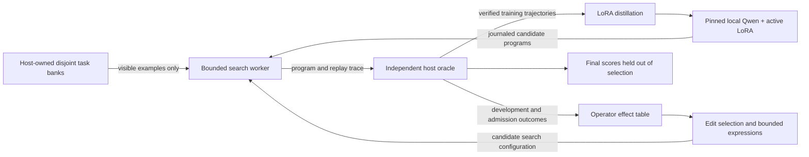

# RSI laboratory implementation

The system searches for short string programs, measures edits to the search procedure, transfers its effect table to fresh runs, and trains local Qwen adapters on independently verified solutions. `EXPERIMENT.md` declares the first pilot's design. `runs/<id>/REPORT.md` contains measured results.



## Trusted boundary

The host controls the oracle, banks, acceptance rule, cost accounting, and hash-chained event journal. It sends only a task ID and visible examples to the worker. Neither hidden examples nor reference programs appear in the worker request. The worker's reported outputs are recomputed by an independent AST interpreter. A forged success or replay mismatch fails closed.

The candidate interface accepts only named numeric search settings and bounded arithmetic expressions for edits. It has no file-write, import, shell, or network operation. Expression validation rejects unknown fields, excessive depth, nonfinite values, and out-of-bounds results. This is an interface boundary for model-generated proposals; it is not an operating-system sandbox against arbitrary code running as the same user. Hash chains detect later event corruption but do not authenticate against a host administrator.

## Search and cost

The published interpreter supplies primitive semantics inside the search worker; the host uses a separate implementation. Atom enumeration uses only visible input/output examples, followed by exact prefix pruning, best-first graph search, progressive widening, and canonical syntactic transpositions. Syntactically distinct programs that agree on visible examples are retained because they may diverge on hidden inputs. The selected answer uses visible information only; the oracle never chooses the best candidate on the final bank.

The pilot's grammar uses the published position range and up to four atoms. It is an enumerative synthesizer with neural candidate proposals, not a full copy of GATS or a general Python agent. Classical enumeration is a strong baseline in this domain. Enumeration cost, expansions, replay work, and oracle calls are recorded separately; equal expansion budgets alone do not establish equal total computation.

## What changes

The initial edit catalog adjusts search costs, progress weight, and widening. A table records each operator's trials, positive development effects, admissions, and later descendant effects. Thompson-style selection combines positive-effect evidence and measured gains. Admission is recorded separately so an improving candidate that loses to another candidate is not mislabeled as a failed trial. Descendant credits describe observed lineages and are not causal estimates. The V5 diagnostic found sparse nonzero credit and only two local adaptive-transfer choice flips when removing that score term under fixed historical draws. See `analysis/descendant-credit-20260916.md`; this is not an ablated policy rollout.

The local model can propose new arithmetic edit expressions; valid proposals still need replay, execution sensors, development improvement, and admission non-regression. Any accepted extension is compared with removing it at the same number of later edit opportunities. This extends the catalog inside a fixed metalanguage; the prototype does not establish unrestricted invention of new algorithms.

A common macro library is harvested from verified training solves and frozen across the pilot's search and inheritance arms. This deliberately makes effect-table inheritance measurable without confounding it with a larger solution library. Future macro-growth experiments need a separate ablation.

## Model training and replay

Three independent LoRA adapters share a frozen model backbone: search distillation, fixed-search distillation, and self-training. All begin with identical adapter tensors. Pilot v2 first trains a shared bootstrap adapter on verified search solutions and copies its tensors into each arm, verifying identical hashes. Later training tasks exclude the bootstrap tasks. Prompt tokens are masked out of the training loss. Every target is a candidate trajectory that passes both visible and hidden training examples; reference program strings never become training targets directly. Checkpoint outputs and raw generations are saved.

The CPU inheritance portion holds the symbolic amplifier substrate fixed while learning edits. Pilot v1's neural block used preselected generation-3 and generation-6 configurations. Pilot v2 interleaves the components: the current adapter generates candidates for three meta-edit generations; the resulting search configuration harvests verified solutions; distillation changes the adapter; and the next round starts from those updated weights, search settings, and effect table. The implementation supports a feedback loop, but whether that loop produces improving improvers remains an empirical question.

Replay means re-executing the deterministic search with the same configuration, examples, and saved neural proposals. GPU generations are saved as inputs rather than regenerated for bit-exactness. Pinning a model revision is necessary for provenance but does not make arbitrary GPU kernels bit-identical across machines.

## Reproduction

### Search-space and frontier diagnostics

`rsi.atom_pool_partial` allows pieces empty on some visible examples;
`rsi.search_diagnostic` selects the original or corrected pool and records up to
64 unique cost-ordered candidates. `rsi.search_reachability` separately checks
bounded visible fit by prefix dynamic programming. Grading occurs after search.
These isolated modules preserve the historical default worker.

The source diagnostic improved first-choice correctness 357 -> 401/576 and
coverage@64 398 -> 458, with 21 first-choice regressions and higher actual cost.
The auditor reexecutes frozen searches, regrades frontiers and independently
checks visible reachability using shared pool builders. The exhaustive fragment
audit found no useful single addition in the available source memories.
Results and limitations: `search-diagnostic-results-2026-09-16.md`.
Fresh cost-controlled validation precedes kernel promotion or frontier training.

Fresh validation is now complete: `run_search_validation.py` executes a frozen
grid on new template-disjoint seed groups, closes all searches before grading,
and records per-call CPU/wall time and exact replays. `audit_search_validation.py`
regenerates banks, reexecutes searches and independently reconstructs the fixed
mixture and outcomes. V8 passed its coverage screen with costs and regressions;
see `search-validation-results-2026-09-16.md`. `analyze_search_changes.py` links
every changed first choice to program representations and saved larger-budget
frontiers. This is a separate experimental workflow; the historical worker
remains versioned as before. Frontier distillation is the next untested step.

### Verified-frontier neural study (v11 audited; v12 planned)

`run_frontier_distillation.py` freezes new harvest and compares original first
choice, corrected first choice, first verified frontier candidate and the full
verified frontier. `rsi.frontier_training` draws tasks uniformly before programs,
with a fixed anchor allocation and cumulative harvest. The existing finite
admission rule controls promotion; rejected weights are restored exactly.

The new generation path saves completion token IDs and prompt lengths. The
auditor decodes those IDs, reconstructs prompt/supervised token counts with the
pinned tokenizer, checks sampled outputs and diversity using the published
interpreter, reconstructs training draws, and verifies checkpoint lineage.
Training itself is not replayed. Actual shared harvest costs and per-arm logical
costs are distinguished. Final scores are deferred until all decisions close.

A small GPU fixture passed the complete audit before the full study launched.
It verifies implementation, not neural improvement. V9 terminated with CUDA
memory exhaustion after four decisions. V9b completed decisions but failed its
publication audit because of a strict-oracle contract mismatch. V11 reran the
study after that contract repair, passed its independent archive audit, and
failed its engineering screen; see
`analysis/frontier-distillation-v11-report.md`.

V11 used three training seeds sharing one final bank and bootstrap, and its
matched steps and examples did not match total compute or target-token
counts. The `rsi.accounting` helpers and tests define shared versus
arm-specific cost vectors, but the sealed historical runner is unchanged
because its fixture pins the runner source hash. The planned V12 executor must
integrate that accounting and enforce equal vector budgets, alongside
independent bank groups and larger held-out banks; see
`EXPERIMENT-v12-compute-matched-multiseed.md`.
`summarize_frontier_distillation.py` renders completed, audited runs into a
per-change report and JSON evidence links. It reexecutes the independent audit,
checks all archive hashes before/after audit and before publication, and stores
a receipt plus the extra audit cost. Reports are written outside the sealed run;
a stale `audit.json` status alone cannot authorize publication.

### Balanced inheritance calibration (v4)

`rsi.inheritance_run` isolates table inheritance from weight training, macro
growth and catalog extension. It calibrates all twelve existing edit types,
then restarts g0/g3/g6, scrambled and random conditions from the same ancestor.
All optimization closes before the shared final bank is scored. The declared
protocol is `EXPERIMENT-v4-inheritance.md`.

Each evaluation records its public request, hash, raw selected programs,
oracle outcomes, replay flag and cost delta. Each edit links parent/candidate
evaluations to its before/after statistics and its selection or rejection reason.
`audit_inheritance.py` regrades with the published interpreter and independently
reconstructs tables, decisions, transplants, final lineage and paired contrasts.
It does not call the evolutionary runner to decide whether the recorded choice
was valid. It also does not independently rerun every search or authenticate the
host. A valid hash chain alone cannot establish experimental correctness.

V5 enables selection traces without changing the selector: every score term,
beta draw, selected name and RNG state hash is recorded. The audit reconstructs
the choices from the initial seed and table history. `explain_change.py` renders
a single edit's selection rationale, parameter diff, measured task wins/losses,
costs and acceptance reason. It matches evaluations by request hash **and**
trajectory label, so repeated identical requests do not misattribute timing.
Explanations are written outside the sealed archive and do not replace its audit.

```powershell
.\.venv\Scripts\python.exe explain_change.py runs/inheritance-20260916-v4 transfer/g0/10043/g3/p1 --output analysis/v4-seed43-accepted-edit.md
```

V4 lacks draw traces; its explanation explicitly says the selection ranking was
not recorded. The newer trace explains the implemented heuristic, not a proven
causal mechanism or a calibrated probability of improvement.

Cost counters are logical charges, including cached work charged again for
replay. Oracle counts are upper bounds where the interpreter short circuits.
Worker elapsed time and whole-run elapsed time are separately defined. Source
acquisition is not free and remains separate from downstream edit opportunities.

```powershell
.\.venv\Scripts\python.exe -m rsi.inheritance_run --config configs/inheritance-v4.json --run-id YOUR_NEW_RUN_ID
.\.venv\Scripts\python.exe audit_inheritance.py runs\YOUR_NEW_RUN_ID
```

Those commands create a new experiment. To inspect an existing result, run only
the audit against its saved archive; final-bank reuse is not a new replication.

### Fragment-proposer inheritance diagnostic

`rsi.library` learns a candidate memory from verified harvest solutions and
proposes single additions to a bounded active macro library. `rsi.library_run`
compares memories from different source generations while resetting every target
solver to the original configuration and library. This keeps learned proposals
separate from a pre-improved artifact. Numeric-pair and frozen-library controls
share the task/query schedule. Protocol: `EXPERIMENT-v7-library.md`.

`audit_library.py` reconstructs fragment provenance, scrambled compositions,
visible rankings, candidate changes, admission decisions, inherited memory,
common starts, cost totals and final holdout ordering without calling the
library learner. The established published-interpreter checker regrades outputs.
`explain_library_change.py` renders one generation from a sealed archive.
This is a dedicated diagnostic, not integrated neural-loop behavior. V7 failed:
no fragment addition changed verified correctness, while numerical edits had a
small heterogeneous mean gain. See `library-results-2026-09-16.md`.

`rsi.search_reopen` is a separate kernel that preserves cheaper routes to an
already-generated syntactic state. The default worker retains `rsi.search` for
historical protocols. A source-only diagnostic and `audit_reopening.py` verified
its route correction but found no coverage improvement on the recorded source
proposals. Future experiments must select/version a kernel explicitly.

### Offline context diagnostic after the failed inheritance replication

`rsi.contextual` extracts public task examples, parent settings and signed edit
effects from audited source development records. `run_context_diagnostic.py`
performs nested whole-source regression comparisons and archives every fold,
prediction and ranking. `audit_context_diagnostic.py` reconstructs regressions
with augmented least squares and checks data partitions, permutations, metrics
and the advancement screen. It shares feature/extraction definitions and reuses
the previously audited oracle labels. This is an offline component; it does not
change `operators.select` or the live evolution runner.

The completed v6 diagnostic failed its screen. Prediction improved modestly,
but ranking did not beat parent-only and exceeded unconditional means in just
1/9 sources. See `context-diagnostic-results-2026-09-16.md`. A rerun on the same
data is a reproducibility check, not a new replication.

### Retention diagnostic added after the failed v2 pilot

`rsi.retention_run` isolates the weight-update problem using three arms: fresh trajectories, cumulative verified replay, and replay with a validation gate. The full v2 loop remains available as the historical control and still uses its original automatic model retention. The new policy must be integrated and re-tested in the full loop after the controlled diagnostic; the existence of a separate gate does not fix historical results.

The retention gate scores parent and candidate on a fresh validation slice each round, retains every candidate artifact, and verifies rejected-update rollback with exact tensor hashes. Final generations are scored only after all decisions close. Per-step training draws and loss, gradient norms, pool hashes, lineage hashes, raw samples and cost deltas make each decision reviewable. The model sees only visible examples for validation/final tasks. The host-owned oracle and same-user trust limitations still apply.

Run and audit the predeclared diagnostic:

```powershell
.\.venv\Scripts\python.exe -m rsi.retention_run --config configs/retention-v3.json --run-id YOUR_NEW_RUN_ID
.\.venv\Scripts\python.exe audit_retention.py runs\YOUR_NEW_RUN_ID
```

It requires the retained v2 bootstrap checkpoint and verified harvest identified in the configuration. Previous-bank template exclusions are recorded per run, so later invocations intentionally receive different exclusions; replay an archived experiment from its saved bank rather than assuming the seed alone recreates it.

Run from this project directory in PowerShell:

```powershell
uv venv --python 3.12 .venv
uv pip install --python .venv\Scripts\python.exe torch==2.8.0 --index-url https://download.pytorch.org/whl/cu128
uv pip install --python .venv\Scripts\python.exe -r requirements.lock.txt --extra-index-url https://download.pytorch.org/whl/cu128
git clone https://github.com/izzortsi/trapdoor-loom.git vendor\trapdoor-loom
git -C vendor\trapdoor-loom checkout dd78141b423b661571f873d55f157b4e8a01e615
.\.venv\Scripts\python.exe -m pytest -q
.\.venv\Scripts\python.exe prepare_model.py --config configs/pilot-v2.json
.\.venv\Scripts\python.exe -m rsi.run --config configs/pilot.json
```

The last command runs the original CPU experiment. Use `--config configs/pilot-v2.json` for the calibrated experiment and add `--neural` after downloading the model snapshot pinned in that configuration. The neural runner loads only local model files, uses GPU index 1 by default, and does not call a paid API. Every run uses a new directory and refuses to overwrite a previous run ID. Every new run snapshots its source and protocol. Keep failed runs when fixing implementation errors.

The original reference paper is [2606.07856](https://arxiv.org/abs/2606.07856); the upstream [repository](https://github.com/izzortsi/trapdoor-loom) is retained with its Git provenance. The pilot changes model size, training schedule, task splits, prompting, precision, and search method, so its results must not be labeled a reproduction of that paper.
