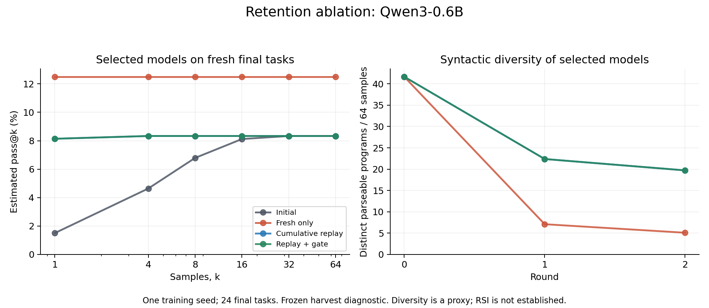

# Retention pilot: results and what changed

Run: [retention-20260916-v3](runs/retention-20260916-v3/REPORT.md). Protocol: [declared design](EXPERIMENT-v3-retention.md). Independent [audit](runs/retention-20260916-v3/audit.json) passed. This experiment did not demonstrate RSI or establish a successful retention policy.

## Controlled result

All arms started from the identical saved Qwen3-0.6B bootstrap adapter. They used the same fixed verified search harvest and optimizer settings. Only the training pool and whether the coverage gate controlled selection changed.

| Condition | Initial pass@64 | Round 1 | Round 2 | Final distinct parseable programs per 64 samples |
| --- | ---: | ---: | ---: | ---: |
| Fresh round only | 2/24 | 3/24 | 3/24 | 5.08 |
| Cumulative verified replay | 2/24 | 4/24 | 2/24 | 19.71 |
| Replay plus validation gate | 2/24 | 4/24 | 2/24 | 19.71 |

The baseline averaged 41.67 distinct parseable programs. Replay retained substantially more syntactic variety than fresh-only training in this controlled setup. It did not preserve the extra task coverage gained in round one. Its second update lost two final tasks and gained none. Fresh-only retained its three tasks. The final replay-minus-fresh difference was one task (−4.17 percentage points); a descriptive paired-task bootstrap interval was [−12.5, 0] points. One seed and 24 tasks cannot establish general superiority of either training policy.

## Why the gate did not protect the final result

Both replay updates satisfied the predeclared rule on their respective 12-task validation slices. Round two lost no validation tasks, gained one and improved pass@1. On the independent final bank, the same update lost two tasks. Therefore the gated and ungated arms retained identical updates and had identical results.

This is an observed generalization failure of this small validation gate. Exact rollback passed a real adapter-mutation test, but neither live update triggered rollback. That test establishes the ability to restore weights; it does not establish that the gate recognizes every harmful update.

The evidence does not identify whether task mix, limited validation sample size, optimization strength, or another factor explains the mismatch. The result does show that preserving syntactic variety and passing this admission test are insufficient to demonstrate retained capability. Do not increase the threshold or select the first-round checkpoint after inspecting these final scores and report that as an unbiased success.

## What this explains about the previous failure

The v2 analysis linked fresh-only training with output concentration. This intervention supports a narrower claim: replay changes the concentration outcome under fixed inputs and training settings. The predicted downstream benefit—sustained large-k coverage—was absent. It remains inappropriate to call the earlier regression definitively solved or to attribute it solely to forgetting.

The new final bank excludes reference templates from all prior local banks. It can therefore be harder or differently composed than v2's bank. Compare arms within v3; do not compare its 2/24 baseline directly with v2's 7/24 as a model regression.

## Logging and verification

- 96 artifact files hashed; 322 journal events verified.
- 19,968 validation and final generations regraded with the published interpreter.
- 410 training-pool rows rechecked; this counts repeated rows across arms/rounds, not 410 unique solutions.
- All six gate decisions and parent/candidate/selected checkpoint links independently reconciled.
- Per-step draw indices reconciled against recorded pools; 288 optimizer steps, 217,601 generated tokens, 23,657 supervised tokens.
- Experiment duration: 532.7 seconds; token counts and wall time are measured separately. Nominal steps/samples are matched; total compute is not.
- 30 current tests passed after adding search-edit decision records. Two expected PEFT warnings concern tiny test models without pretrained configuration files.

The plot is a derived artifact outside the sealed run archive. The main experiment used the pinned project environment. Plotting used system Python with Matplotlib 3.10.9; the project virtual environment lacks Matplotlib. This presentation dependency did not affect training or scoring.

## Next discriminating work

1. Replicate the fixed-data contrast across independent neural seeds before adopting or rejecting replay as a general policy.
2. Predeclare larger, stratified admission banks and an independent audit of admission errors. Maintain a fresh final bank and count all admission cost. More validation is a hypothesis to test, not a guarantee.
3. Test reduced update strength and parent-policy regularization as separate interventions while holding replay fixed. Avoid combining repairs so their effects become unidentifiable.
4. Reconnect a validated update policy to the full search–distill loop, then repeat coverage, common-ancestor improver, table-inheritance and compute-matched controls. Those RSI requirements remain open.
